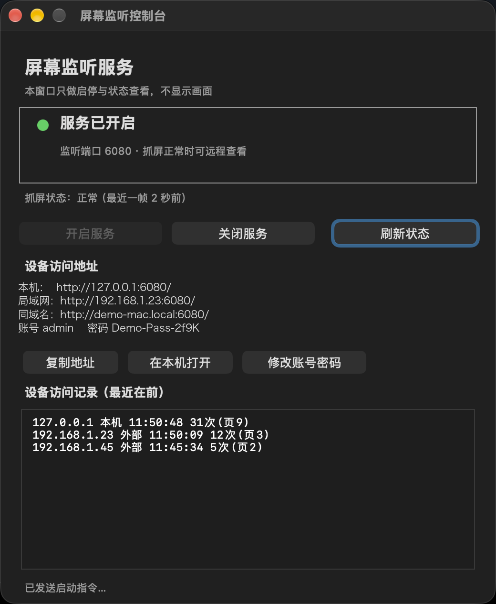
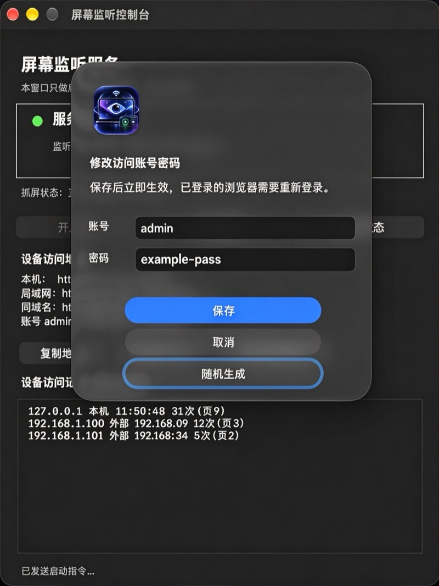
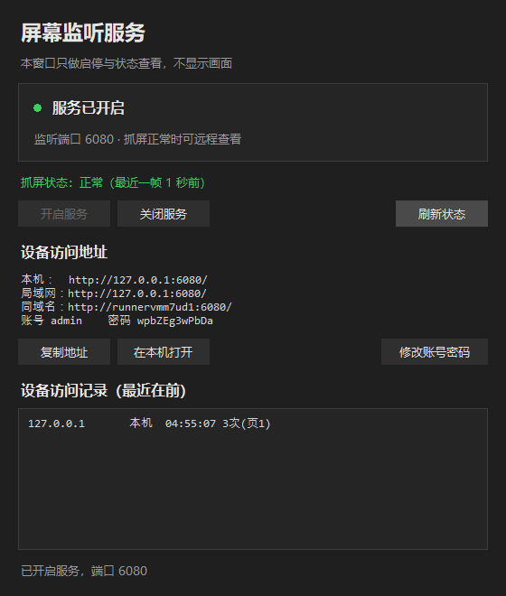

# Screen Listen Console

A tiny app that lets you **watch the screen of a Mac or PC from a browser, read-only**, on the same local network. macOS and Windows builds are feature-identical.

The app is just a console: start/stop the service, show status, list the URLs to open, and show who has connected. **It never shows the live picture** and offers no mouse or keyboard control.


[](https://github.com/Forest0622/screen-listen-console/actions/workflows/build.yml)

[中文说明](README.md)

## Screenshots

| macOS main window | macOS change credentials |
|---|---|
|  |  |

Windows console (captured on a GitHub Actions Windows runner; the password is the throwaway value generated for that run):



> The macOS screenshots use demo values (`192.168.1.23`, `demo-mac.local`, `Demo-Pass-2f9K`), not real network details.

## What it does

- Status box: service on/off, listening port, whether capture is healthy (with the age of the latest frame)
- Buttons: start service / stop service / refresh status
- Access URLs: `127.0.0.1`, the LAN IP, and the `.local` hostname — copy one or open it locally; the current username and password are printed right below them
- **Change credentials**: opens a small dialog to edit the username/password, or hit "random" to generate a 14-character password; saving takes effect immediately
- Access log: per-client IP, first/last visit, hit count, number of pages opened

## Credentials

- A **12-character random password is generated on first launch** (the alphabet omits look-alikes `l`, `I`, `0`, `O`) and stored in `~/.remote-view/config.json` with mode `600`. It is also printed once to `~/.remote-view/logs/service.log` in case you lose it.
- Two ways to change it, neither requires a restart:
  - click "Change credentials" in the app, or
  - edit `~/.remote-view/config.json` (`{"user": "admin", "password": "…"}`) directly.
- The server compares the file `mtime` on every request, so edits apply at once; the app re-reads it every 1.5 s, so the displayed password follows along.
- Constraints: username must not be empty, password at least 6 characters.

## How it works

Short version: **periodic screenshots + browser polling**. No macOS Screen Sharing, no VNC.

```
screencapture -x -t jpg  →  sips downscale to 1600 px wide / quality 55
        ↓ every second
  latest frame kept in memory  →  HTTP server (port 6080, Basic auth)
        ↓
  browser /           → viewer page (pause, zoom, fullscreen)
  browser /frame.jpg  → the latest frame
  browser /status     → JSON status
```

- The capture thread idles at one frame per 2 s and speeds up to 1 s while someone is viewing
- Failures back off exponentially (2 s … 60 s; permission errors at least 30 s) so the system prompt is not retriggered in a loop
- `/status` reports `ok` only if a frame was captured within the last 20 s, not merely because an old frame exists
- Client stats are written to `clients.json` (atomic replace, 3 s throttle); per-page detail goes to `access.log`

## Requirements

- macOS 11 or newer
- Python 3 (comes with the Command Line Tools: `xcode-select --install`)
- Screen Recording permission for the app (once per machine)

## Quick start

```bash
git clone https://github.com/Forest0622/screen-listen-console.git
cd screen-listen-console
./make-app.sh            # builds dist/屏幕监听控制.app
open "dist/屏幕监听控制.app"
```

1. Click "Start service"
2. Grant Screen Recording on first run: System Settings → Privacy & Security → Screen & System Audio Recording → add the app and toggle it on → quit the app (`⌘Q`) and reopen it
3. Wait until the status line says capture is healthy
4. The username and password for this run are shown under the access URLs; use them from any device on the same LAN

## Building a DMG

```bash
./make-dmg.sh            # builds dist/屏幕监听控制-安装包.dmg
```

The image contains the app, a symlink to `/Applications`, and a short readme. Drag the app in to install.

Two things will always happen on someone else's Mac — they are not bugs:

- **Gatekeeper blocks the first launch**: the default build is ad-hoc/self-signed, not notarized. Right-click the app → Open → Open again.
- **The other person must grant Screen Recording themselves**: TCC permission is per machine, it cannot travel with the bundle.

## Windows build

The Windows edition is a separate implementation with the same behaviour: a Python + Tkinter console, screen capture through Pillow (GDI), and **the same server endpoints, port, authentication, config file format and on-screen information** as the macOS build.

**Install**: download `ScreenListenConsoleSetup-1.2.0.exe` and run it. No administrator rights needed — it installs per user; a "Screen Listen Console" shortcut appears in the Start menu (and on the desktop if you tick the box).

**Use**: open it, press "Start service". The window shows three entry points — `http://127.0.0.1:6080/`, the LAN IP and the computer name — plus the current username and password.

- Config: `%LOCALAPPDATA%\ScreenListenConsole\config.json` (a random 12-character password is generated on first run, changeable in the app)
- Access log: `logs\clients.json` in the same folder
- Same port and image settings as macOS, also overridable with `RV_PORT`

**How it works**: `Pillow.ImageGrab` (all monitors at once) → resized to 1600px wide, JPEG quality 55 → latest frame kept in memory, exposed through the same `/`, `/frame.jpg` and `/status` endpoints.

**Building it yourself** (on Windows):

```bat
pip install pillow pyinstaller
python -m PyInstaller --noconfirm --onefile --windowed --name ScreenListenConsole ^
  --icon windows\assets\AppIcon.ico --add-data "windows/assets/AppIcon.ico;assets" ^
  --distpath windows\dist --workpath windows\build windows\app.py
"C:\Program Files (x86)\Inno Setup 6\ISCC.exe" windows\installer.iss
```

There is no Screen Recording permission gate on Windows. The service still listens on `0.0.0.0:6080`; the Windows firewall asks once on first start — allow the private network.

## Continuous integration

`.github/workflows/build.yml` runs two runners per push/PR: macOS compiles the app and builds the DMG; Windows builds the `.exe` with PyInstaller and wraps it in an Inno Setup installer. The Windows job first runs a self-test (config creation, 401/200 auth, frame output, hot reload, page content, produced exe), and only then produces the installer. A `v*` tag creates a Release with both the DMG and the Windows installer.

## Configuration

| Want to change | Where |
|---|---|
| Username / password | "Change credentials" in the app, or `~/.remote-view/config.json` (Windows: `%LOCALAPPDATA%\ScreenListenConsole\config.json`) |
| Port | `PORT` in `server.py` / `windows/server.py` (also `RV_PORT`); on macOS also `Console.swift`, not needed on Windows |
| Image size / quality | `TARGET_WIDTH`, `INTERVAL` in the matching `server.py` |
| Data directory | macOS `~/.remote-view`, Windows `%LOCALAPPDATA%\ScreenListenConsole`; both overridable with `RV_DATA_DIR` |

## Known limitations (all measured, not laziness)

- **macOS Screen Sharing cannot be driven by noVNC**: it only offers Apple's private authentication (`RFB 003.889`, security types `30/33/36/35`) and none of the classic VNC password type 2, so third-party clients fail during the handshake. That is why this project uses screenshots + a web page instead.
- **No launchd agent or login item**: a process started by `launchd` (gui domain) never receives Screen Recording permission, so capture always fails and the user cannot grant it to that process. The app must be opened manually.
- **LAN only**: no tunneling or reverse proxy is included. For remote access, put it behind a VPN / Tailscale / your own reverse proxy, and change the password.
- **Read-only**: no mouse or keyboard control, no clipboard.

## Security notes

- HTTP Basic auth is **plaintext** on the LAN; do not use it on public Wi-Fi
- The service listens on `0.0.0.0:6080`; anyone who can reach the port sees the login prompt. A leaked password means a watched screen
- The password is random per machine rather than a hard-coded default, but the app and the config file display it in clear text — mind that when sharing screenshots
- `clients.json` / `access.log` contain client IPs; they are ignored by git (see `.gitignore`)

## Layout

```
server.py                 capture service, macOS (Python standard library only)
Console.swift             the console UI (AppKit, compiled by swiftc)
make-app.sh               build and assemble the .app
make-dmg.sh               build the DMG installer
assets/AppIcon.icns       icon
docs/使用说明.txt          end-user readme shipped inside the DMG (Chinese)
docs/images/              screenshots
windows/server.py         Windows capture service (Pillow ImageGrab)
windows/console.py        Windows console (Tkinter)
windows/app.py            Windows entry point (also hosts --selftest)
windows/selftest.py       source-level self-test
windows/installer.iss     Inno Setup installer script
windows/assets/AppIcon.ico Windows icon
.github/workflows/        CI build and release
```

## License

MIT
