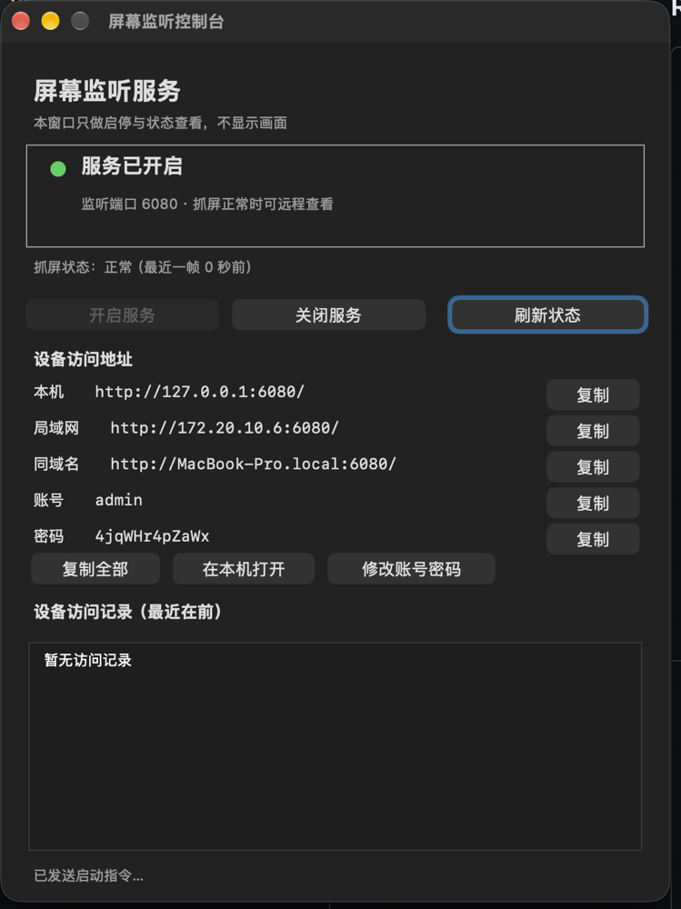
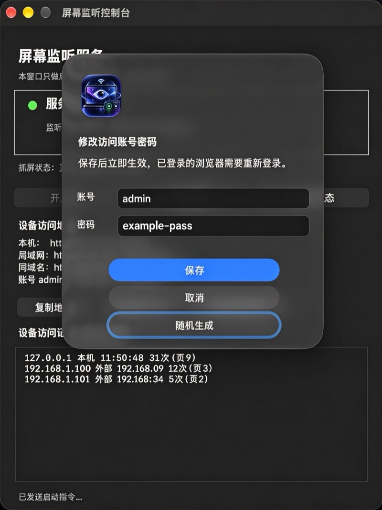
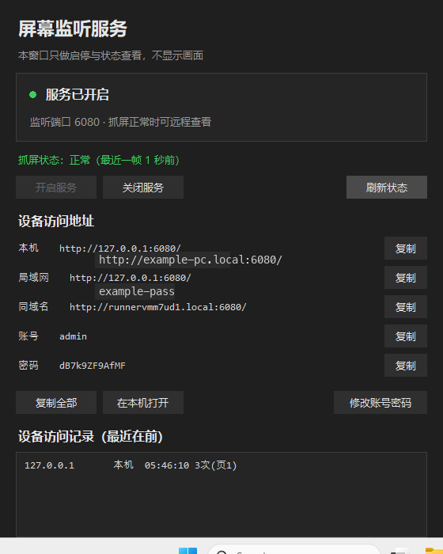
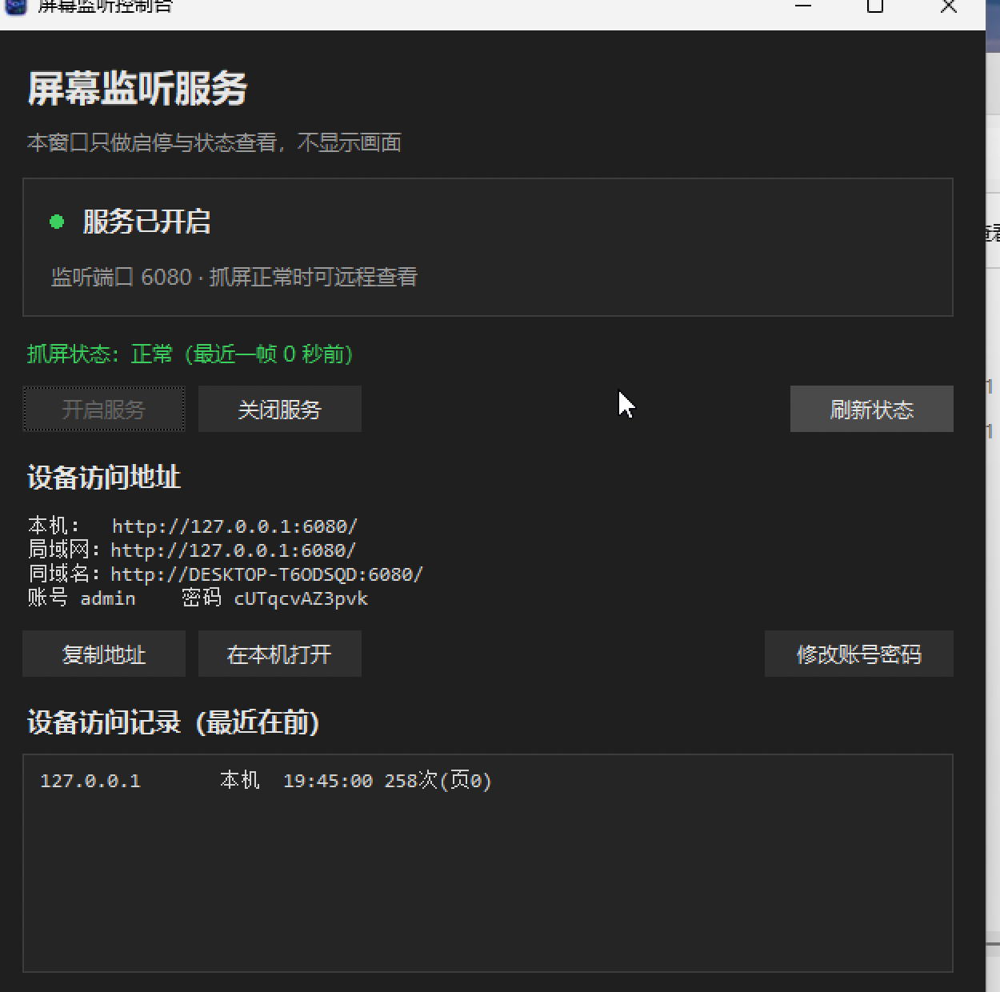

# 屏幕监听控制（Screen Listen Console）

在同一个局域网里，用浏览器**只读查看**一台电脑当前屏幕的小工具，**macOS 和 Windows 都有**，功能完全一致。

App 本身是一个轻量控制台：只负责开关服务、显示状态、给出访问地址、记录谁访问过——**不显示实时画面**，也不提供鼠标键盘控制。


[](https://github.com/Forest0622/screen-listen-console/actions/workflows/build.yml)

[English README](README.en.md)

## 界面截图

| macOS 主界面 | macOS 修改账号密码 |
|---|---|
|  |  |

Windows 版控制台（这一张是 GitHub Actions 的 Windows 运行器上实拍的，密码为当次临时生成值）：



Windows 11 真机验证（原生 ARM64 虚拟机，不是 CI）：



上面这张是 **v1.2.0 时期**在 VMware Fusion 里装的一台原生 **Windows 11（ARM64，系统版本 10.0.26300.9457）** 上用 `ScreenListenConsoleSetup-1.2.0.exe`（20,418,925 字节，与那份 Release 附件同一份文件）实拍的（当时「设备访问地址」还是三行合并布局；v1.3.0 起改成五行逐行复制，Windows 端新界面见上一张 CI 实拍）：安装向导（选择“仅为我安装” → 默认安装目录 → 完成并启动）全部走完，控制台正常渲染，点「开启服务」后监听 `6080`、抓屏状态显示「正常（最近一帧 0 秒前）」，访问记录里出现 `127.0.0.1` 的真实访问，防火墙提示也按正常流程弹出。

> 这台虚拟机没有可用的网络适配器（Windows 11 ARM 下 e1000e 无驱动，也没装 VMware Tools），所以「局域网」一行回落到 `127.0.0.1`，「同域名」显示的是计算机名 `DESKTOP-T60DSQD`；联网正常的 Windows 机器上会显示真实局域网 IP。截图里密码是这台虚拟机内自动生成的临时随机值。

> macOS 两张截图取自本机实拍画面：密码已临时换成演示值 `Demo-Pass-2f9K`（不是真实密码），「局域网」和「同域名」两行显示的是这台 Mac 的真实内网地址与主机名。

## 它长什么样

- 状态框：服务开启 / 关闭、监听端口、抓屏是否正常（带最近一帧的时间）
- 一排按钮：开启服务 / 关闭服务 / 刷新状态
- 设备访问地址：本机 `127.0.0.1`、局域网 IP、`.local` 主机名、账号、密码，**每一行各占一行、各带一个「复制」按钮**，想复制哪一项就点哪一行后面的按钮；账号和密码也是各自独立复制，不用先复制一整段再手工截取；下方另有「复制全部」把五行一起复制，以及「在本机打开」直接拉起浏览器
- 「修改账号密码」：弹出输入框改账号密码，也可以点「随机生成」换一个 14 位强随机密码，保存即生效
- 访问记录：按客户端 IP 累计首次/最近访问时间、访问次数、打开过的页面

## 账号密码

- **第一次运行自动生成 12 位随机密码**（字符集去掉了容易看混的 `l` `I` `0` `O`），写入 `~/.remote-view/config.json`，权限 `600`；同时在 `~/.remote-view/logs/service.log` 里打印一行，忘了可以去看
- 换密码有两种办法，都不用重启服务：
  - App 里点「修改账号密码」
  - 直接编辑 `~/.remote-view/config.json`（`{"user": "admin", "password": "…"}`）
- 服务端每次请求都比对文件 `mtime`，文件一变立刻生效；客户端每 1.5 秒重读一次，界面上显示的账号密码会跟着变
- 密码长度要求 ≥ 6 位，账号不能为空

## 工作原理

一句话：**定时截图 + 网页轮询**，没有用系统自带的屏幕共享，也没有用 VNC。

```
screencapture -x -t jpg  →  sips 压到 1600px 宽 / 质量 55
        ↓ 每 1 秒
  内存里保留最新一帧  →  HTTP 服务（端口 6080，Basic 认证）
        ↓
  浏览器 /            → 带工具栏的查看页（暂停、缩放、全屏）
  浏览器 /frame.jpg   → 最新一帧
  浏览器 /status      → JSON 状态
```

- 抓屏线程空闲时降频（2 秒一帧），有请求时 1 秒一帧
- 抓屏失败按指数退避（最短 2 秒，最长 60 秒；权限类至少 30 秒），避免失败时连环弹系统授权框
- `/status` 的 `ok` 不只看有无旧图，还要求 20 秒内抓到过新帧，避免"报正常但其实缺权限"
- 访问记录按 IP 累计写入 `clients.json`（原子替换 + 3 秒节流），页面级明细写 `access.log`

## 环境要求

- macOS 11 及以上
- Python 3（macOS 装了命令行工具就有；没有就 `xcode-select --install`）
- 需要给 App 授予「屏幕录制」权限（**每台机器一次**）

## 快速开始

```bash
git clone https://github.com/Forest0622/screen-listen-console.git
cd screen-listen-console
./make-app.sh            # 产出 dist/屏幕监听控制.app
open "dist/屏幕监听控制.app"
```

1. 点「开启服务」
2. 首次会要求「屏幕录制」权限：系统设置 → 隐私与安全性 → 录屏与系统录音 → 添加并打开开关 → `⌘Q` 退出 App 再重新打开
3. 看到「抓屏状态：正常」即可
4. 窗口「设备访问地址」下方就是本次生成的账号密码，同一局域网的其他设备用它登录浏览

## 打包成安装包

```bash
./make-dmg.sh            # 产出 dist/屏幕监听控制-安装包.dmg
```

DMG 内含 App、一个指向「应用程序」的软链和一份使用说明，拖进去即可安装。

分发到别人的 Mac 时有两件必然会发生的事，不是 bug：

- **首次打开被 Gatekeeper 拦**：本项目的默认签名是本机自签 / ad-hoc，没有 Apple 公证。右键点 App →「打开」→ 再点一次「打开」。
- **对方必须自己授权一次「屏幕录制」**：TCC 权限按机器授予，无法随包携带。

## Windows 版

Windows 版是独立实现的同款：Python + Tkinter 控制台，截图换成 Pillow（GDI），**服务端接口、端口、认证方式、配置文件格式、界面上显示的信息都与 macOS 版一致**。

**安装**：下载 `ScreenListenConsoleSetup-1.3.1.exe` 双击运行，不需要管理员权限，装在当前用户目录下；装完开始菜单和桌面（安装时勾选）会有「屏幕监听控制」。

**使用**：打开后点「开启服务」，界面会给出 `http://127.0.0.1:6080/`、局域网 IP、计算机名三个入口，以及当前账号密码。

- 配置文件：`%LOCALAPPDATA%\ScreenListenConsole\config.json`（首次启动自动生成 12 位随机密码，在 App 里也能改）
- 访问记录：同目录下 `logs\clients.json`
- 端口与画质参数和 macOS 版相同，都支持 `RV_PORT` 环境变量覆盖

**原理**：`Pillow.ImageGrab`（多显示器一起抓）→ 缩到 1600px 宽、JPEG 质量 55 → 内存里保存最新一帧，对外暴露与 macOS 版同一套 `/`、`/frame.jpg`、`/status` 接口。

**自己构建**（在 Windows 上）：

```bat
pip install pillow pyinstaller
python -m PyInstaller --noconfirm --onefile --windowed --name ScreenListenConsole ^
  --icon windows\assets\AppIcon.ico --add-data "windows/assets/AppIcon.ico;assets" ^
  --distpath windows\dist --workpath windows\build windows\app.py
"C:\Program Files (x86)\Inno Setup 6\ISCC.exe" windows\installer.iss
```

Windows 上没有「屏幕录制」授权这一关，装完直接能用。服务同样监听 `0.0.0.0:6080`，首次启动 Windows 防火墙会弹窗，选「允许专用网络」。

安装包没有做代码签名，首次运行 Windows 可能会弹 SmartScreen 提示（「Windows 已保护你的电脑」）：点「更多信息」→「仍要运行」即可，这和 macOS 上的 Gatekeeper 提示是一回事。

## 自动构建

`.github/workflows/build.yml` 在每次 push / PR 时并行跑两个 runner：macOS 上编译 App、打 DMG，Windows 上用 PyInstaller 打包 `.exe` 并生成 Inno Setup 安装包；Windows 任务会先跑一遍自检（配置生成、401/200 认证、出帧、热加载、页面内容、exe 产物），全部通过才产出安装包。推一个 `v*` 标签时自动创建 Release，同时附上 DMG 和 Windows 安装包。

## 自定义

| 想改什么 | 改哪里 |
|---|---|
| 账号密码 | App 里点「修改账号密码」，或改 `~/.remote-view/config.json`（Windows：`%LOCALAPPDATA%\ScreenListenConsole\config.json`） |
| 端口 | `server.py` / `windows/server.py` 的 `PORT`（也支持 `RV_PORT` 环境变量）；macOS 还要改 `Console.swift`，Windows 不用 |
| 画质 / 宽度 | 对应平台的 `TARGET_WIDTH`、`INTERVAL` |
| 数据目录 | macOS 默认 `~/.remote-view`、Windows 默认 `%LOCALAPPDATA%\ScreenListenConsole`，两边都可用 `RV_DATA_DIR` 覆盖 |

## 已知限制

- **macOS 的系统「屏幕共享」接不进 noVNC**：它只提供 Apple 私有认证（`RFB 003.889`，安全类型 `30/33/36/35`），没有经典 VNC 的密码类型 2，所以第三方 VNC 客户端在握手阶段就被挡下。这就是本项目改用"截图 + 网页"的原因。
- **不能用 launchd 常驻或开机自启**：`launchd`（gui 域）启动的进程拿不到「屏幕录制」权限，抓屏必然失败，且用户无法在设置里单独给它授权。所以本工具只能手动打开 App 再点开启。
- **仅限局域网**：没有做内网穿透或反向代理。要在公网访问，请自己套 VPN / Tailscale / 反代，并务必换掉密码。
- **只读**：不提供键鼠控制，不传输剪贴板。

## 安全提示

- HTTP Basic 认证在局域网内是**明文**传输的，不要在公共 Wi-Fi 上开
- 服务监听 `0.0.0.0:6080`，同网段任何人只要能连上端口就能看到登录框；密码一旦泄露等于屏幕被看
- 密码首次运行随机生成，不再是硬编码的固定值；但 App 界面和配置文件会明文显示它，截图/分享界面时注意打码
- 访问日志包含客户端 IP，属于隐私数据，别提交进仓库（仓库已通过 `.gitignore` 排除）

## 目录结构

```
server.py                 截图服务（macOS，Python 标准库，零依赖）
Console.swift             控制台（AppKit 手写布局，swiftc 直接编译）
make-app.sh               编译并组装 .app
make-dmg.sh               打包 DMG 安装盘
assets/AppIcon.icns       图标
docs/使用说明.txt          随安装包分发的说明
docs/images/              界面截图
windows/server.py         Windows 截图服务（Pillow ImageGrab）
windows/console.py        Windows 控制台（Tkinter）
windows/app.py            Windows 入口（也承载 --selftest）
windows/selftest.py       源码级自检
windows/installer.iss     Inno Setup 安装包脚本
windows/assets/AppIcon.ico Windows 图标
.github/workflows/        自动构建与发布
```

## License

MIT
